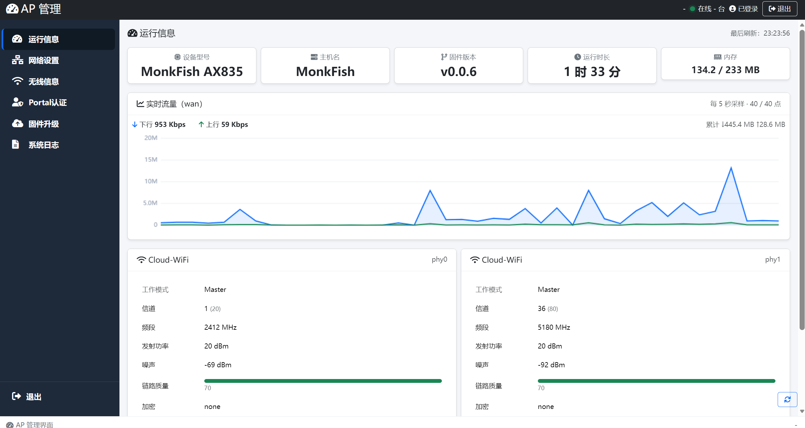
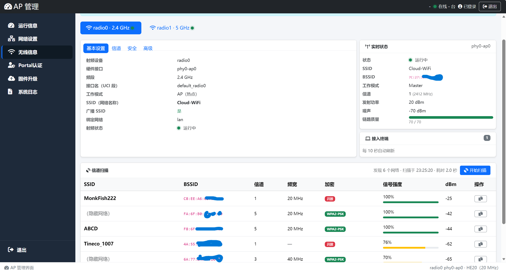
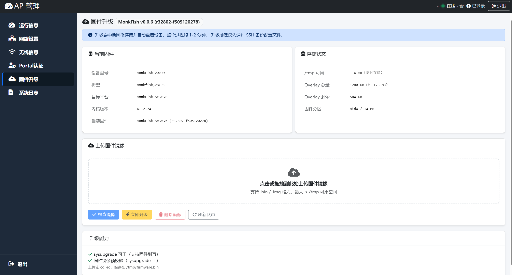

<div align="center">

# AP-UI

**A LuCI-free AP management web interface for OpenWrt, built on ubus + rpcd + ucode.**

**完全不再依赖 LuCI 的 OpenWrt AP 管理界面，基于 ubus + rpcd + ucode。**

[English](#english) · [简体中文](#简体中文)

</div>

---

## English

### Overview

**AP-UI** is a lightweight, self-contained web management interface for OpenWrt-based access points. It does **not** depend on LuCI in any way — no Lua, no LuCI controllers, no `luci-base` UI. The browser talks directly to OpenWrt's native `ubus` / `rpcd` JSON-RPC bus, and a thin ucode middle layer (the `mk.ap*` ubus objects) performs all privileged operations.

It targets embedded APs with tiny overlays (as small as ~900 KB), so the entire frontend is plain static HTML + a handful of CSS/JS assets served by `uhttpd`, and the backend is a few kilobytes of ucode scripts.

```text
Browser ──POST /ubus──▶ uhttpd ──▶ rpcd (JSON-RPC) ──▶ ucode plugin (mk.ap*)
                                                          │
                                                          ├─▶ uci    (config read/write)
                                                          ├─▶ ubus   (system / network / log)
                                                          └─▶ files  (/proc, /sys, /tmp)
```

### Screenshots

| Dashboard | Wireless | Firmware |
| :---: | :---: | :---: |
|  |  |  |

### Features

- **Dashboard (运行信息)** — system / board / firmware KPIs, memory usage, uptime; a real-time uplink traffic chart (front-end differential sampling of `/proc/net/dev`, uplink interface auto-detected via the default gateway's bridge FDB entry); per-radio status cards; live client list (`iwinfo assoclist`).
- **Network settings (网络设置)** — switch `br-lan` between DHCP client and static IPv4, with IP / prefix / gateway / DNS editing and validation.
- **Wireless info (无线信息)** — read-only radio & interface parameters from `uci wireless` + `network.wireless status`, live channel / TX power / noise / link quality via `iwinfo`, and on-demand channel scanning.
- **Firmware upgrade (固件升级)** — drag-and-drop sysupgrade image upload (via `cgi-io` to `/tmp/firmware.bin`), image verification (`sysupgrade -T`), md5/sha256, and an explicit confirmed flash.
- **System log (系统日志)** — `logd` ring buffer viewer with All / System / Auth tabs, level filter, keyword search, auto-refresh, and a `CLEAR`-confirmation reset.
- **Login / session** — reuses rpcd's built-in `session` object; the session id is kept in `localStorage`, expired sessions auto-redirect to the login page.
- **Portal status (backend object)** — `mk.apportal` exposes a read-only view of the `webauthd` Portal / RADIUS / whitelist configuration and runtime state (process, ports, nginx proxy).

### Project structure

```text
ap-ui/
├── Makefile                                  OpenWrt package recipe (self-contained)
├── files/etc/uci-defaults/95-ap-ui           first-boot script (site root redirect + rpcd restart)
├── snapshots/                                screenshots for this README
└── src/                                      the single payload source of truth
    ├── www/                                  → /www/apui/        (static frontend)
    │   ├── login.html  index.html  network.html
    │   ├── wireless.html  upgrade.html  logs.html
    │   └── assets/{css,js,layout,webfonts}
    └── usr/share/rpcd/
        ├── ucode/*.uc                        → /usr/share/rpcd/ucode/   (mk.ap* ubus objects)
        └── acl.d/*.json                      → /usr/share/rpcd/acl.d/  (role definitions)
```

### Requirements

Installed automatically as package dependencies:

| Package | Purpose |
| --- | --- |
| `uhttpd`, `uhttpd-mod-ubus` | HTTP server + `/ubus` JSON-RPC endpoint |
| `rpcd`, `rpcd-mod-file`, `rpcd-mod-ucode`, `rpcd-mod-iwinfo` | RPC daemon, file ACL, ucode plugin loader, `iwinfo` provider |
| `ucode`, `ucode-mod-fs`, `ucode-mod-uci`, `ucode-mod-ubus` | ucode runtime + fs / uci / ubus modules |
| `cgi-io` | firmware upload (`/cgi-bin/cgi-upload`) |
| `logd` | system log source |

No `luci-*`, `nftables`, `iw` or `dnsmasq` dependency.

### Installation into an OpenWrt build tree

```sh
# Option 1 — copy the package directly
cp -a ap-ui <openwrt>/package/

# Option 2 — add as a local feed
echo "src-link apui <absolute-repo-path>" >> feeds.conf
./scripts/feeds update apui && ./scripts/feeds install ap-ui
```

Then:

```sh
make menuconfig                     # Network → ap-ui  (Monkfish Softwares → Monkfish Software)
make package/ap-ui/compile          # build the .ipk only
make                                # build the full firmware (includes this package)
```

The package is architecture-independent (`PKGARCH:=all`) — it ships only scripts and static pages.

### Development deployment (no build required)

Copy the payload onto a running device and symlink it:

```sh
put src/**  → /tmp/apui/
ln -sfn /tmp/apui /www/apui
/etc/init.d/rpcd restart
# open http://<AP-IP>:8000/apui/index.html
```

### API reference (ubus objects)

All objects live in `/usr/share/rpcd/ucode/` and are loaded by rpcd.

| Object | Method | Access | Description |
| --- | --- | --- | --- |
| `mk.apinfo` | `overview` | read | one-shot snapshot: system, network, traffic counters, radios, clients |
| `mk.apnet` | `settings` | read | current `br-lan` proto + runtime/uci addresses + rollback state |
| `mk.apnet` | `settings_set` | write | apply DHCP/static config; validates same-subnet; starts 60 s auto-rollback |
| `mk.apnet` | `rollback_cancel` | write | keep the new settings, cancel the pending rollback |
| `mk.apwireless` | `info` | read | radios & interfaces from `uci wireless` + `network.wireless` |
| `mk.apupgrade` | `info` | read | device / firmware / storage / image / capability info |
| `mk.apupgrade` | `verify` | write | `sysupgrade -T` the uploaded image (no flash) |
| `mk.apupgrade` | `flash` | write | flash the image and reboot — requires `confirm="FLASH"` |
| `mk.apupgrade` | `discard` | write | delete `/tmp/firmware.bin` |
| `mk.apmaint` | `reboot_system` | write | reboot the device — requires `confirm="REBOOT"` |
| `mk.aplogs` | `logs` | read | `logd` entries with tab / level / keyword filtering |
| `mk.aplogs` | `clear` | write | reset the `logd` buffer — requires `confirm="CLEAR"` |
| `mk.apportal` | `info` | read | `webauthd` Portal / RADIUS / whitelist config + runtime state |

The browser also calls two native objects **directly** (never through `mk.*`) to avoid a known ucode nested-`ubus` deadlock inside rpcd-hosted plugins:

- `iwinfo` — `info`, `assoclist`, `scan`
- `webauthd.session` — `list_users`

Access control is defined in [apui.json](file:///c:/D/opensource-monkfish-iot/ap-ui/src/usr/share/rpcd/acl.d/apui.json) (least privilege) alongside the standard [`superuser`](file:///c:/D/opensource-monkfish-iot/ap-ui/src/usr/share/rpcd/acl.d/superuser.json) role.

### Security notes

- **Session-based auth**: every RPC is made with an rpcd session id; a rejected call (`-32002`) clears the local session and redirects to login.
- **Failsafe network changes**: `settings_set` refuses a new IP outside the current subnet, backs up `/etc/config/network`, and arms a 60-second rollback timer that the user cancels with **"Keep changes"**. The rollback runs as a detached `system()` process, so a dropped connection never kills it.
- **Explicit destructive confirmations**: firmware flash requires `FLASH`, reboot requires `REBOOT`, log clear requires `CLEAR`.
- **Secrets are never echoed**: Wi-Fi keys and RADIUS secrets are only reported as "set / not set".

### Compatibility

Developed and tested against an OpenWrt-based AP firmware (Monkfish AX835 / NatShell AX835, firmware v0.0.6, kernel 6.12.74). It should work on any reasonably recent OpenWrt with `rpcd-mod-ucode` and `ucode-mod-ubus`.

### License

Licensed under the **Apache License, Version 2.0**. The full text is in [LICENSE](file:///c:/D/opensource-monkfish-iot/ap-ui/LICENSE).

```
Copyright 2026 Monkfish IoT

Licensed under the Apache License, Version 2.0 (the "License");
you may not use this file except in compliance with the License.
You may obtain a copy of the License at

    http://www.apache.org/licenses/LICENSE-2.0
```

---

## 简体中文

### 项目简介

**AP-UI** 是一套面向 OpenWrt 接入点（AP）的轻量、自包含 Web 管理界面。它**完全不依赖 LuCI**：没有 Lua，没有 LuCI 控制器，也不依赖 `luci-base` 的 UI。浏览器直接与 OpenWrt 原生的 `ubus` / `rpcd` JSON-RPC 总线通信，由一层极薄的 ucode 中间层（`mk.ap*` ubus 对象）负责所有特权操作。

项目面向 overlay 空间极小的嵌入式 AP（可小至约 900 KB）：整个前端是纯静态 HTML + 少量 CSS/JS 资源，由 `uhttpd` 提供；后端是几 KB 的 ucode 脚本。

```text
浏览器 ──POST /ubus──▶ uhttpd ──▶ rpcd (JSON-RPC) ──▶ ucode 插件 (mk.ap*)
                                                        │
                                                        ├─▶ uci    （配置读写）
                                                        ├─▶ ubus   （system / network / log）
                                                        └─▶ 文件    （/proc、/sys、/tmp）
```

### 界面截图

| 运行信息 | 无线信息 | 固件升级 |
| :---: | :---: | :---: |
|  |  |  |

### 功能特性

- **运行信息** —— 系统 / 板型 / 固件 KPI、内存占用、运行时长；上行口实时流量曲线（前端对 `/proc/net/dev` 差分采样，上行口由默认网关在网桥 FDB 中的落口自动定位）；各射频状态卡片；在线终端列表（`iwinfo assoclist`）。
- **网络设置** —— `br-lan` 在 DHCP 客户端与静态 IPv4 之间切换，支持 IP / 前缀 / 网关 / DNS 编辑与校验。
- **无线信息** —— 从 `uci wireless` + `network.wireless status` 读取射频与接口参数（只读），实时信道 / 发射功率 / 噪声 / 链路质量来自 `iwinfo`，并支持按需信道扫描。
- **固件升级** —— 拖拽上传 sysupgrade 镜像（经 `cgi-io` 落到 `/tmp/firmware.bin`）、镜像校验（`sysupgrade -T`）、md5/sha256，以及需显式确认的刷写。
- **系统日志** —— `logd` 环形缓冲查看器，支持 全部 / 系统 / 认证 分页、级别过滤、关键字搜索、自动刷新，以及需输入 `CLEAR` 确认的重置。
- **登录 / 会话** —— 复用 rpcd 自带的 `session` 对象，会话 id 存于 `localStorage`，失效自动跳转登录页。
- **Portal 状态（后端对象）** —— `mk.apportal` 提供 `webauthd` 的 Portal / RADIUS / 白名单配置与运行状态（进程、端口、nginx 代理）只读视图。

### 目录结构

```text
ap-ui/
├── Makefile                                  OpenWrt 打包配方（自包含）
├── files/etc/uci-defaults/95-ap-ui           首启脚本（站点根跳转 + 重启 rpcd）
├── snapshots/                                本 README 的截图
└── src/                                      唯一载荷真源
    ├── www/                                  → /www/apui/        （静态前端）
    │   ├── login.html  index.html  network.html
    │   ├── wireless.html  upgrade.html  logs.html
    │   └── assets/{css,js,layout,webfonts}
    └── usr/share/rpcd/
        ├── ucode/*.uc                        → /usr/share/rpcd/ucode/   （mk.ap* ubus 对象）
        └── acl.d/*.json                      → /usr/share/rpcd/acl.d/   （角色定义）
```

### 依赖

以下依赖由包自动引入：

| 包 | 用途 |
| --- | --- |
| `uhttpd`、`uhttpd-mod-ubus` | HTTP 服务 + `/ubus` JSON-RPC 入口 |
| `rpcd`、`rpcd-mod-file`、`rpcd-mod-ucode`、`rpcd-mod-iwinfo` | RPC 守护进程、文件 ACL、ucode 插件加载、`iwinfo` 提供者 |
| `ucode`、`ucode-mod-fs`、`ucode-mod-uci`、`ucode-mod-ubus` | ucode 运行时及 fs / uci / ubus 模块 |
| `cgi-io` | 固件上传（`/cgi-bin/cgi-upload`） |
| `logd` | 系统日志来源 |

不依赖 `luci-*`、`nftables`、`iw`、`dnsmasq`。

### 编译安装（接入 OpenWrt 构建树）

```sh
# 方式一 —— 直接复制本包
cp -a ap-ui <openwrt>/package/

# 方式二 —— 作为本地 feed
echo "src-link apui <仓库绝对路径>" >> feeds.conf
./scripts/feeds update apui && ./scripts/feeds install ap-ui
```

随后：

```sh
make menuconfig                     # Network → ap-ui  （Monkfish Softwares → Monkfish Software）
make package/ap-ui/compile          # 只出 ipk
make                                # 出整机固件（会带上本包）
```

本包与架构无关（`PKGARCH:=all`），仅包含脚本与静态页面。

### 开发期部署（免编译）

把载荷拷到运行中的设备并做软链：

```sh
put src/**  → /tmp/apui/
ln -sfn /tmp/apui /www/apui
/etc/init.d/rpcd restart
# 访问 http://<AP-IP>:8000/apui/index.html
```

### 接口一览（ubus 对象）

所有对象位于 `/usr/share/rpcd/ucode/`，由 rpcd 加载。

| 对象 | 方法 | 权限 | 说明 |
| --- | --- | --- | --- |
| `mk.apinfo` | `overview` | 读 | 一次性返回：系统、网络、流量计数、射频、终端 |
| `mk.apnet` | `settings` | 读 | `br-lan` 当前协议 + 运行时/uci 地址 + 回滚状态 |
| `mk.apnet` | `settings_set` | 写 | 应用 DHCP/静态配置；同网段校验；启动 60 秒自动回滚 |
| `mk.apnet` | `rollback_cancel` | 写 | 保留新设置，取消待执行的回滚 |
| `mk.apwireless` | `info` | 读 | 来自 `uci wireless` + `network.wireless` 的射频与接口 |
| `mk.apupgrade` | `info` | 读 | 设备 / 固件 / 存储 / 镜像 / 能力信息 |
| `mk.apupgrade` | `verify` | 写 | 对上传镜像执行 `sysupgrade -T`（不刷写） |
| `mk.apupgrade` | `flash` | 写 | 刷写并重启 —— 需要 `confirm="FLASH"` |
| `mk.apupgrade` | `discard` | 写 | 删除 `/tmp/firmware.bin` |
| `mk.apmaint` | `reboot_system` | 写 | 重启设备 —— 需要 `confirm="REBOOT"` |
| `mk.aplogs` | `logs` | 读 | `logd` 日志，支持 分页 / 级别 / 关键字 过滤 |
| `mk.aplogs` | `clear` | 写 | 重置 `logd` 缓冲 —— 需要 `confirm="CLEAR"` |
| `mk.apportal` | `info` | 读 | `webauthd` 的 Portal / RADIUS / 白名单配置与运行状态 |

浏览器还会**直接**调用两个原生对象（不经 `mk.*`），以规避 rpcd 托管插件内嵌套 `ubus` 调用导致的死锁：

- `iwinfo` —— `info`、`assoclist`、`scan`
- `webauthd.session` —— `list_users`

访问控制定义在 [apui.json](file:///c:/D/opensource-monkfish-iot/ap-ui/src/usr/share/rpcd/acl.d/apui.json)（最小权限），并配套标准的 [`superuser`](file:///c:/D/opensource-monkfish-iot/ap-ui/src/usr/share/rpcd/acl.d/superuser.json) 角色。

### 安全说明

- **基于会话的鉴权**：所有 RPC 携带 rpcd 会话 id；调用被拒（`-32002`）时清除本地会话并跳转登录页。
- **网络改动带回滚兜底**：`settings_set` 拒绝写入与当前网段不同的新 IP，备份 `/etc/config/network`，并启动 60 秒回滚定时器，用户以「保留修改」取消。回滚以分离的 `system()` 进程运行，断线不会将其杀死。
- **破坏性操作需显式确认**：刷固件需 `FLASH`，重启需 `REBOOT`，清日志需 `CLEAR`。
- **密钥永不回显**：Wi-Fi 密钥与 RADIUS 密钥仅回传「是否已设置」。

### 兼容性

在基于 OpenWrt 的 AP 固件（Monkfish AX835 / NatShell AX835，固件 v0.0.6，内核 6.12.74）上开发与实测。任何具备 `rpcd-mod-ucode` 与 `ucode-mod-ubus` 的较新 OpenWrt 均可运行。

### 许可证

本项目采用 **Apache License 2.0** 许可。完整条款见 [LICENSE](file:///c:/D/opensource-monkfish-iot/ap-ui/LICENSE)。

```
Copyright 2026 Monkfish IoT

Licensed under the Apache License, Version 2.0 (the "License");
you may not use this file except in compliance with the License.
You may obtain a copy of the License at

    http://www.apache.org/licenses/LICENSE-2.0
```
